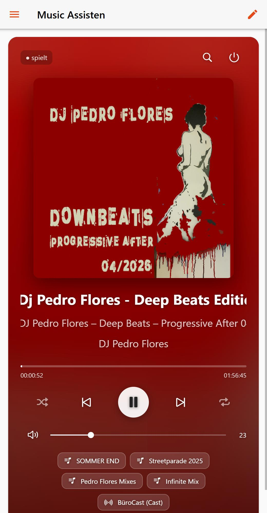
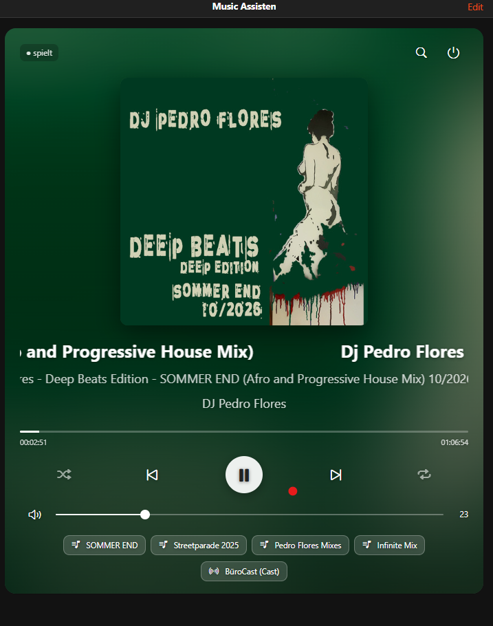
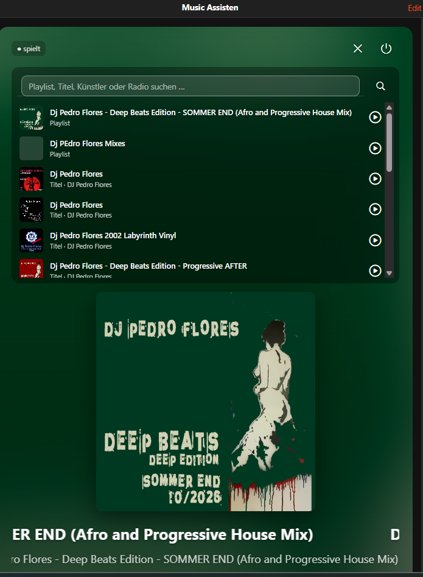

# Music Assistant Player – openHAB Widget

[English](#english) · [Deutsch](#deutsch)

  

---

## English

A "Now Playing" card for the [Music Assistant binding](https://github.com/hww3/oenhab-musicassistant), styled after the Music Assistant web UI.

### Features

- **Background follows the cover**: the album art is blurred behind the card, so the colours adapt to every track automatically. No rule needed.
- **Scrolling text**: long titles and album names scroll like a marquee.
- **Controls**: play/pause, previous/next, shuffle, repeat (off → all → one), volume, mute, power. A progress bar shows the elapsed and total time.
- **Player selection**: one card for all players. Tap the player chip to choose another player; playing players are marked with ♪.
- **Search**: search playlists, tracks, albums, artists and radio stations in Music Assistant. Tap a result to play it on the selected player.
- **Quick picks**: chips for your favourite playlists.
- **Play on an empty queue**: if nothing is queued, Play starts a default playlist instead of doing nothing.

### Requirements

- openHAB 4.x or 5.x (tested with 5.2.1)
- [Music Assistant binding](https://github.com/hww3/oenhab-musicassistant) with a configured server bridge
- **JavaScript Scripting** add-on (Settings → Add-on Store → Automation), used for search and playback
- Node.js 18+ on any computer in your network, for the setup script only
- An openHAB API token (Profile → API Tokens → Create new API token)

### Files

| File | Purpose |
|---|---|
| `ma_nowplaying.yaml` | The widget |
| `ma_search_rule.js` | Rule script for search and playback (installed by `setup.js`) |
| `setup.js` | Creates all items, links, the search items and the rule |

### Installation

**1. Create the items**

Every player needs items named `MA_<Player>_<Point>`. The setup script creates them for all players of your Music Assistant server:

```bash
OH_URL=http://<openhab-ip>:8080 OH_TOKEN=<your-api-token> node setup.js --approve
```

On Windows (PowerShell), set the variables first:

```powershell
$env:OH_URL="http://<openhab-ip>:8080"; $env:OH_TOKEN="<your-api-token>"; node setup.js --approve
```

| Option | Meaning |
|---|---|
| `--approve` | Approve new players from the inbox (browser web players are skipped) |
| `--group <Name>` | Equipment group for the players (default `MusicAssistant_Player`, created if missing) |
| `--bridge <UID>` | Music Assistant server to use if you have several |
| `--dry` | Only show what would happen, change nothing |

The script restarts the player things at the end. The binding only sends values when a thing starts, so newly linked items would otherwise stay `NULL`.

**2. Import the widget**

Settings → Developer Tools → Widgets → **+** → paste the content of `ma_nowplaying.yaml` → Save.

**3. Add it to a page**

Open a layout page → Edit → add a block, row and column → **Add widget** → choose `ma_nowplaying` and fill in the settings:

| Setting | Example | Required |
|---|---|---|
| Default player | `MA_Wohnzimmer` (equipment group of a player) | yes |
| Player group | `MusicAssistant_Player` (the `--group` from the setup) | yes |
| Default playlist | `library://playlist/1` | no |
| Quick picks | `Chill\|library://playlist/3;Radio\|tunein://radio/s12345` | no |

Find playlist URIs with the search in the widget, or in Music Assistant under the playlist's details.

### Items per player

`_Power`, `_Volume`, `_Mute`, `_Control`, `_State`, `_CurrentTitle`, `_CurrentArtist`, `_CurrentAlbum`, `_AlbumArt`, `_CurrentImage`, `_Duration`, `_Elapsed`, `_Seek`, `_Shuffle`, `_Repeat`, `_Playlist`

Shared items: `MA_Search_Query`, `MA_Search_Results`, `MA_Search_Play`

### Good to know

- **Play does nothing?** Music Assistant only resumes an existing queue. Start something with the search, a quick pick, or by setting a default playlist.
- **Duplicate players**: Music Assistant often lists a device twice, for example via Chromecast and as a "Universal" player. The setup adds a suffix like "(Cast)" or "(Universal)". Disable the variant you don't need in Music Assistant (Settings → Players).
- **Cover**: the widget loads the cover from the openHAB `AlbumArt` image item, so it also works remotely (for example via myopenHAB). Search results use the providers' public image URLs.
- The widget texts are in German ("spielt", "Suche läuft …"); change them in the YAML if you like.

---

## Deutsch

Eine „Jetzt läuft“-Karte für das [Music-Assistant-Binding](https://github.com/hww3/oenhab-musicassistant), gestaltet wie die Weboberfläche von Music Assistant.

### Funktionen

- **Hintergrund passt sich dem Cover an**: Das Cover liegt unscharf hinter der Karte, dadurch passen sich die Farben jedem Titel automatisch an. Dafür braucht es keine Regel.
- **Lauftext**: Lange Titel und Albumnamen scrollen durch.
- **Steuerung**: Play/Pause, Zurück/Weiter, Shuffle, Repeat (aus → alle → einer), Lautstärke, Stumm, Power. Ein Fortschrittsbalken zeigt die abgelaufene und die gesamte Zeit.
- **Player-Auswahl**: Eine Karte für alle Player. Ein Klick auf den Player-Chip öffnet die Auswahl, gerade spielende Player sind mit ♪ markiert.
- **Suche**: Playlists, Titel, Alben, Künstler und Radiosender in Music Assistant suchen. Ein Klick auf einen Treffer spielt ihn auf dem gewählten Player ab.
- **Schnellwahl**: Chips für deine Lieblings-Playlists.
- **Play bei leerer Warteschlange**: Steht nichts in der Warteschlange, startet Play eine Standard-Playlist, statt nichts zu tun.

### Voraussetzungen

- openHAB 4.x oder 5.x (getestet mit 5.2.1)
- [Music-Assistant-Binding](https://github.com/hww3/oenhab-musicassistant) mit eingerichteter Server-Bridge
- Add-on **JavaScript Scripting** (Einstellungen → Add-on Store → Automation), wird für Suche und Abspielen gebraucht
- Node.js 18+ auf einem beliebigen Rechner im Netzwerk, nur für das Setup-Skript
- Ein openHAB-API-Token (Profil → API Tokens → Create new API token)

### Dateien

| Datei | Zweck |
|---|---|
| `ma_nowplaying.yaml` | Das Widget |
| `ma_search_rule.js` | Regel-Skript für Suche und Abspielen (wird von `setup.js` installiert) |
| `setup.js` | Legt alle Items, Links, die Such-Items und die Regel an |

### Installation

**1. Items anlegen**

Jeder Player braucht Items nach dem Muster `MA_<Player>_<Point>`. Das Setup-Skript legt sie für alle Player deines Music-Assistant-Servers an:

```bash
OH_URL=http://<openhab-ip>:8080 OH_TOKEN=<dein-api-token> node setup.js --approve
```

Unter Windows (PowerShell) setzt du die Variablen zuerst:

```powershell
$env:OH_URL="http://<openhab-ip>:8080"; $env:OH_TOKEN="<dein-api-token>"; node setup.js --approve
```

| Option | Bedeutung |
|---|---|
| `--approve` | Neue Player aus der Inbox übernehmen (Browser-Webplayer werden übersprungen) |
| `--group <Name>` | Equipment-Gruppe für die Player (Standard `MusicAssistant_Player`, wird bei Bedarf angelegt) |
| `--bridge <UID>` | Music-Assistant-Server, falls du mehrere hast |
| `--dry` | Nur anzeigen, was passieren würde, nichts ändern |

Zum Schluss startet das Skript die Player-Things neu. Das Binding sendet Werte nur beim Start eines Things, sonst blieben neu verlinkte Items auf `NULL`.

**2. Widget importieren**

Einstellungen → Developer Tools → Widgets → **+** → Inhalt von `ma_nowplaying.yaml` einfügen → Speichern.

**3. Auf einer Seite einfügen**

Layout-Seite öffnen → Bearbeiten → Block, Zeile und Spalte hinzufügen → **Add widget** → `ma_nowplaying` wählen und die Einstellungen ausfüllen:

| Einstellung | Beispiel | Pflicht |
|---|---|---|
| Standard-Player | `MA_Wohnzimmer` (Equipment-Gruppe eines Players) | ja |
| Player-Gruppe | `MusicAssistant_Player` (die `--group` aus dem Setup) | ja |
| Standard-Playlist | `library://playlist/1` | nein |
| Schnellwahl | `Chill\|library://playlist/3;Radio\|tunein://radio/s12345` | nein |

Playlist-URIs findest du über die Suche im Widget oder in Music Assistant in den Details der Playlist.

### Items pro Player

`_Power`, `_Volume`, `_Mute`, `_Control`, `_State`, `_CurrentTitle`, `_CurrentArtist`, `_CurrentAlbum`, `_AlbumArt`, `_CurrentImage`, `_Duration`, `_Elapsed`, `_Seek`, `_Shuffle`, `_Repeat`, `_Playlist`

Gemeinsame Items: `MA_Search_Query`, `MA_Search_Results`, `MA_Search_Play`

### Gut zu wissen

- **Play macht nichts?** Music Assistant setzt nur eine vorhandene Warteschlange fort. Starte etwas über die Suche, die Schnellwahl oder eine Standard-Playlist.
- **Doppelte Player**: Music Assistant meldet Geräte oft zweimal, z. B. per Chromecast und als „Universal“-Player. Das Setup hängt dann „(Cast)“ oder „(Universal)“ an. Die nicht benötigte Variante deaktivierst du in Music Assistant (Settings → Players).
- **Cover**: Das Widget lädt das Cover aus dem openHAB-Bild-Item `AlbumArt`. Das funktioniert auch von unterwegs (z. B. über myopenHAB). Die Suchergebnisse nutzen die öffentlichen Bild-URLs der Anbieter.
